計算例(1) 合流点を含む河川の計算
====================================
ここでは分合流点を含む河川の計算を行います．

iRICの起動とソルバーの選択
--------------------------

iRICのオープニング画面で，[新しいプロジェクト]を選択(:numref:`01_start` )
   
   .. _01_start:

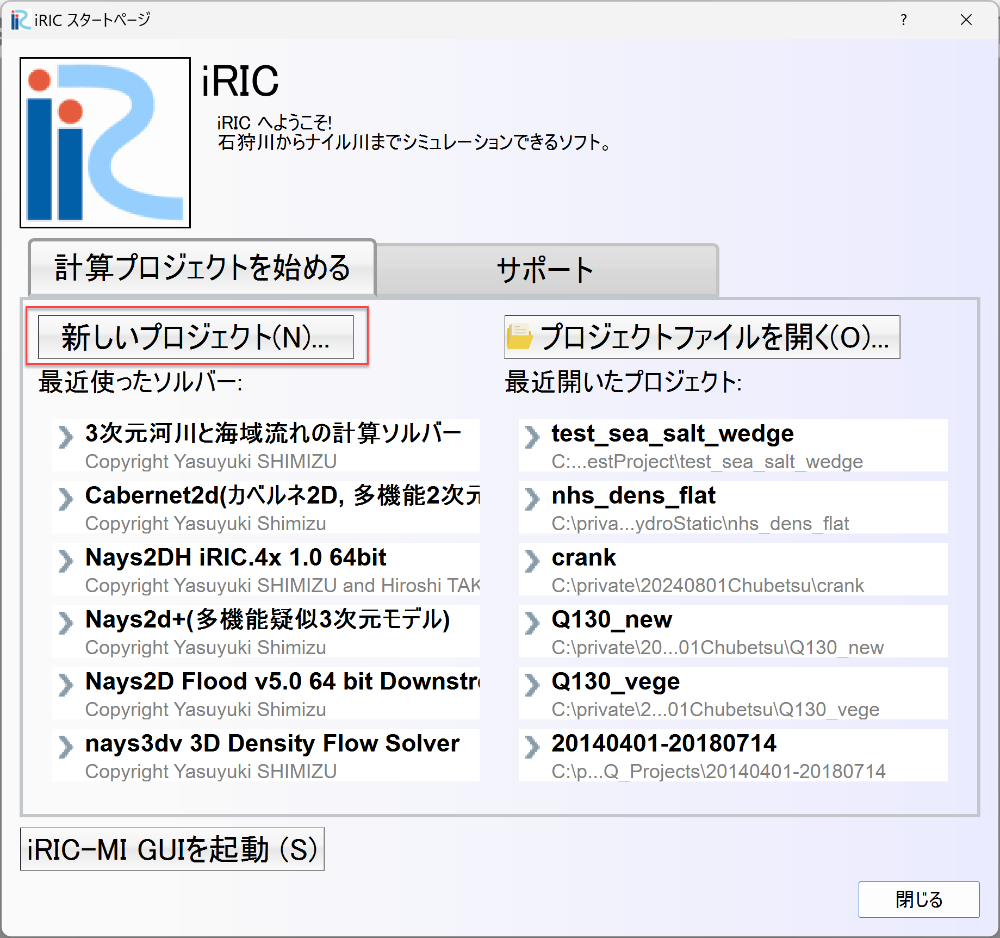

   : 新しいプロジェクト

:numref:`02_select` ソルバーの選択Windowで[Cabernet2d]を選択し，
[OK]を押します．

   .. _02_select:

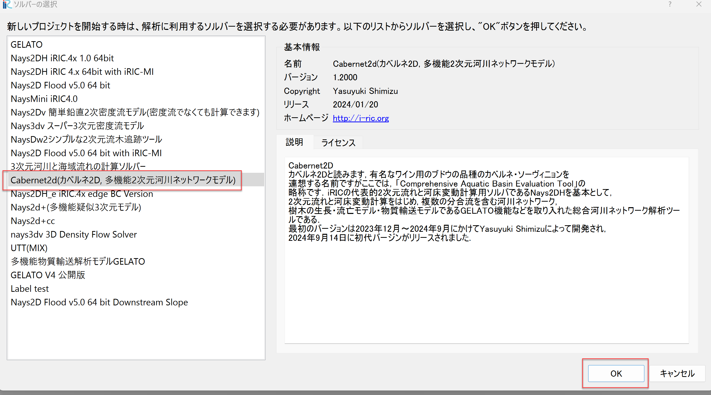

   : ソルバーの選択

計算格子の作成
-------------------
現在のプリプロセッサー画面の縮尺を指定するために下記アニメの要領で基準線(ここでは100m)を設定します．

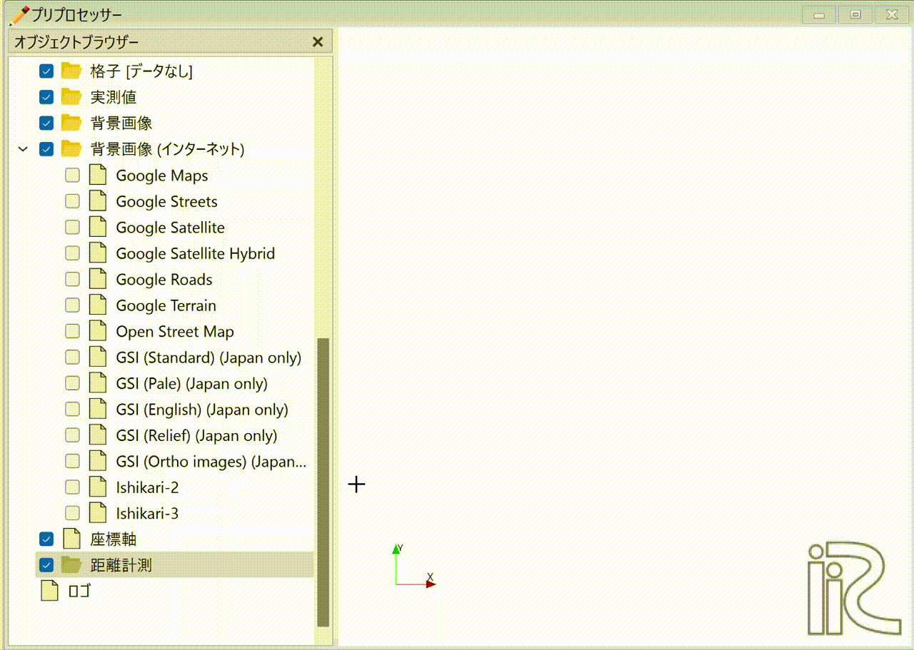

   : 携速線の描画

メインメニューから[格子]→[格子生成アルゴリズムの選択]を選びます．

   .. _koshi_1:

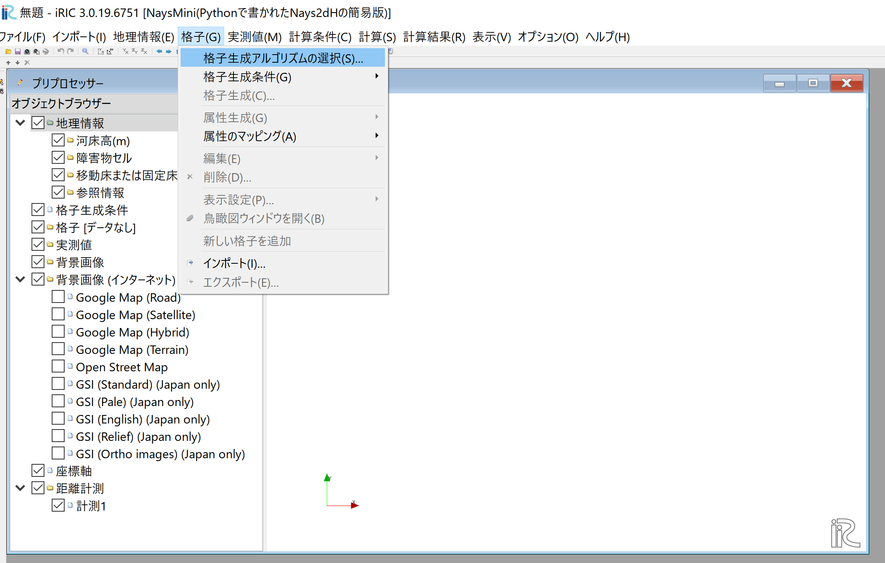

   : 格子生成(1)

[格子生成アルゴリズムの選択]ウィンドウで[汎用格子生成ツール]を選び[OK]を押します．

   .. _koshi_2:

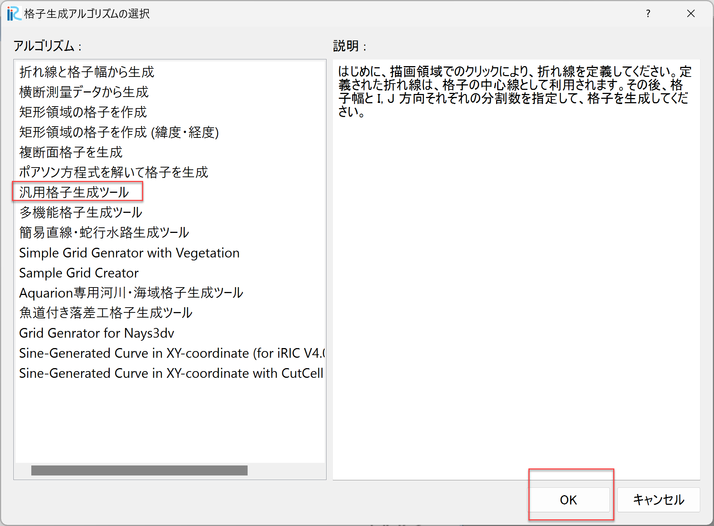

   : 格子生成(2)

「横断測量データーが見つかりません．自分で作成して下さい．」と出るので[OK]を押します．

   .. _warning_1:

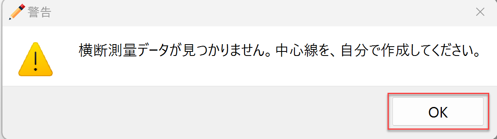

   : 警告画面(1)

以下の手順で格子を生成します．

1. マウス右ボタンをクリックしながら動かして，最後にダブルクリックで河道センターラインを描画する．
2. 描画された基準線上で右マウスをクリックして[左岸線・右岸線の生成(B)]を選択する．
3. 中心線から左右岸までの距離(m)を入力して[OK]を押す．(ここでは左右岸方向に30mづつとる.)
4. 分割線や格子間隔などの条件を指定する.
5. 本川上流部と支川の間の陸地部分を障害物扱いに設定します．

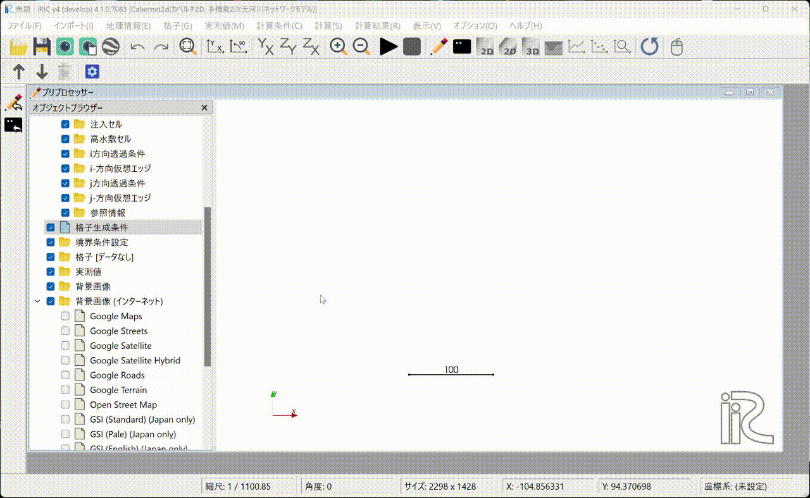

   : 格子生成

境界条件・計算条件の設定
--------------------------

流入・流出部の境界条件を設定します．  

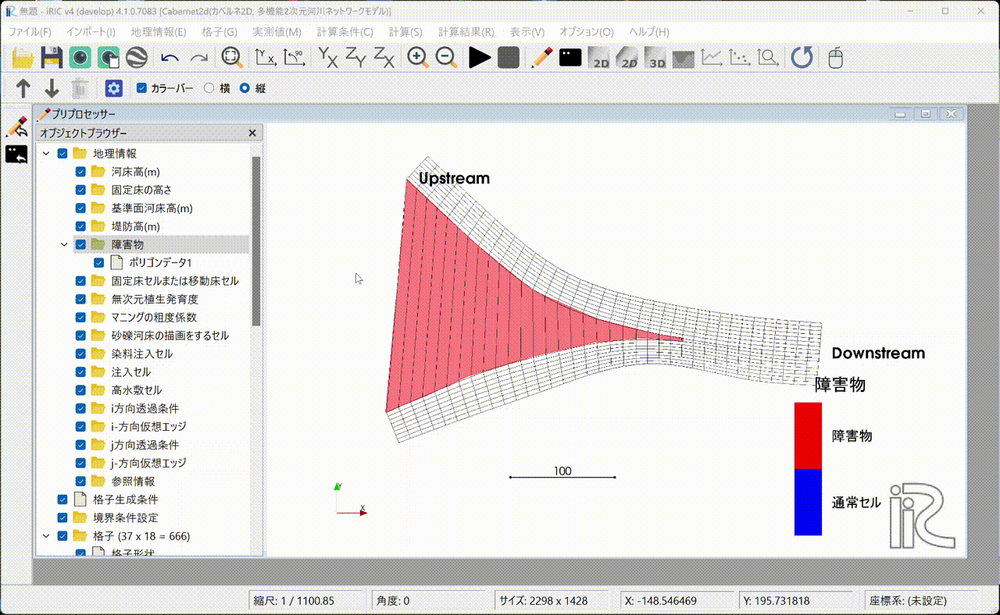

   : 境界条件の設定

障害物情報と境界条件の情報を計算格子にマッピングを行います．

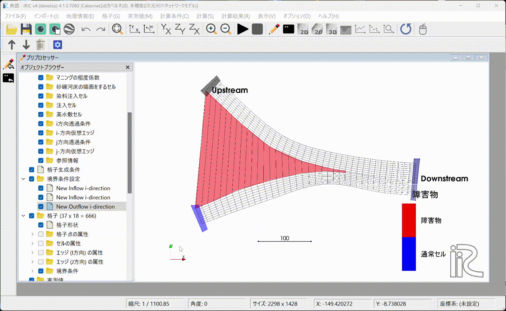

   : マッピングの実行

計算条件の設定を行います．

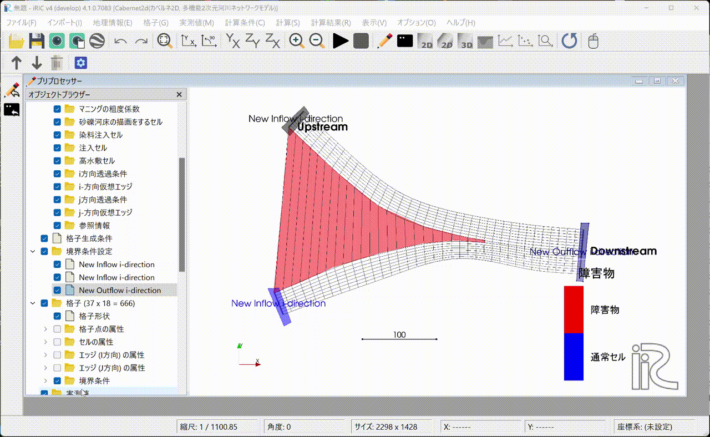

   : 計算条件の設定

計算の実行と計算結果の表示
---------------------------   

計算の実行を行います．初めて実行する際にはプロジェクトを保存するかどうか聞かれます．ここではプロジェクトを新しいフォルダに名前をつけてフォルダとして保存します．好みによってはプロジェクトフォルダを圧縮した形のiproファイルに保存することも出来ます．

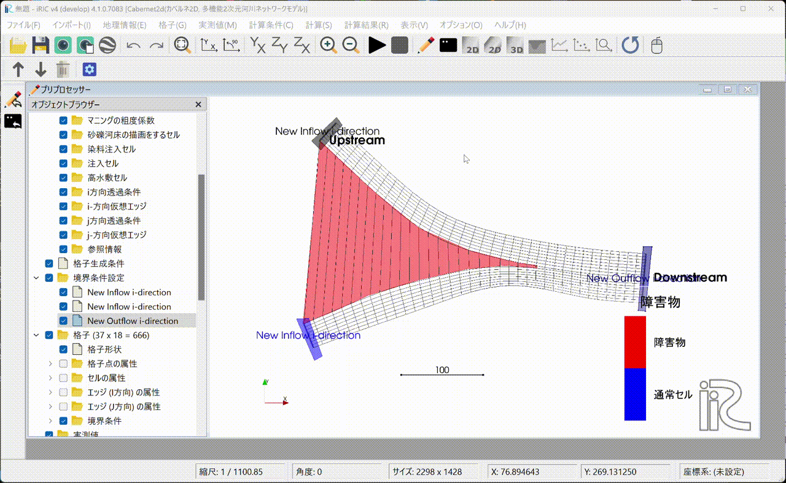

   : 計算の実行

計算結果の表示(1). 2次元ポスト表示Windowを開いて計算結果を表示します．
この例では60秒の計算をしましたが60秒では流れが下流まで届いてないようです．

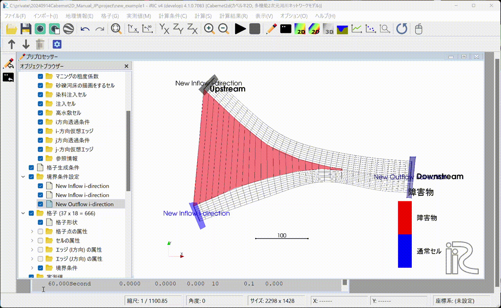

   : 計算結果の表示(1)

計算時間を600秒にします．これに伴って境界条件や計算条件を変更し，再度マッピングを行った後に
計算を再実行し，ポスト表示Windowにて計算結果の表示を行います．

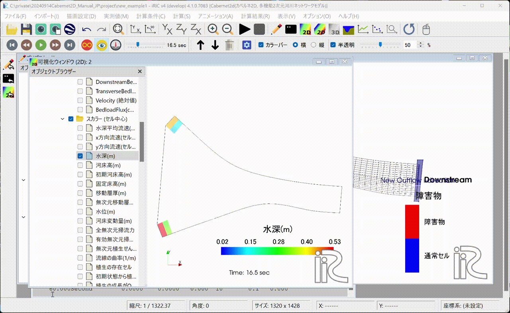

   : 条件の変更，再計算と計算結果の表示(2)

流量ハイドログラフ，水位縦断図などを作ってアニメージョンを作成します．

.. figure:: images_1/ju_anim.gif
   :width: 70%
   :align: center

   : グラフの作成をアニメーションの作成

この結果作成されたアニメーションは下記となります．

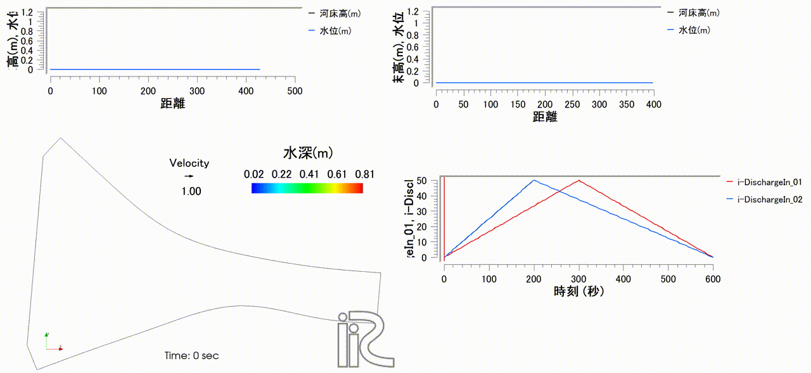

   : 計算結果アニメーション

上記計算結果はYouTubeでも公開中してます．．

.. raw:: html

   <iframe width="560" height="315" src="https://www.youtube.com/embed/K3bJgVvoLF4?si=MjgZuWUNg4Bz5nqB" title="YouTube video player" frameborder="0" allow="accelerometer; autoplay; clipboard-write; encrypted-media; gyroscope; picture-in-picture; web-share" referrerpolicy="strict-origin-when-cross-origin" allowfullscreen></iframe>

