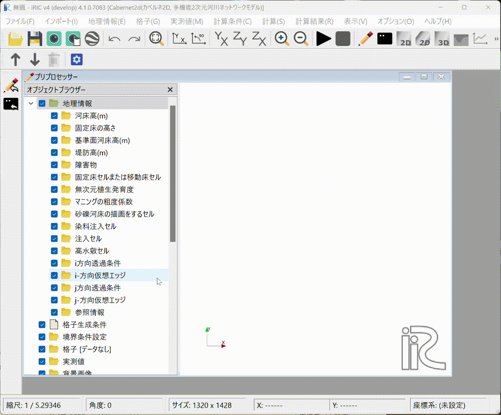
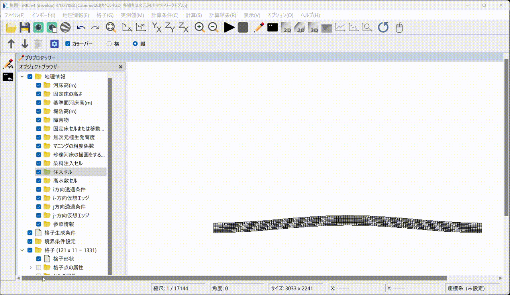
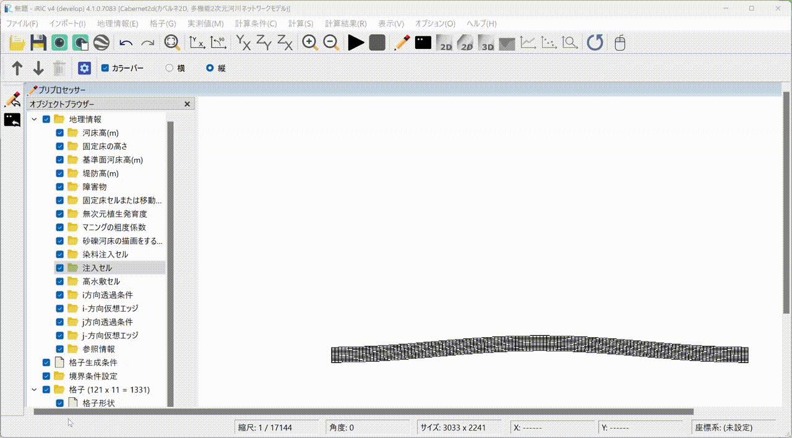

計算例(2) 植生の発生・成長・流亡を含む流れと河床変動の計算
=================================================================

計算格子の作成
--------------------------

メインメニューから[格子]→[格子生成アルゴリズムの選択]を選び以下のアニメーションの手順で
計算格子を生成します．

   .. _grigen(2):

   : 格子生成

計算条件の設定
------------------   

下記アニメーションの手順で計算条件を設定します．

   .. _calcond(2):

   : 計算条件の設定

上記アニメーション中読み込んでいる `流量ハイドログラフファイルはこちら <https://i-ric.org/yasu/cabernet/example2/Linear.csv>`_

`計算条件ファイルはこちら <https://i-ric.org/yasu/cabernet/example2/vegetation.yml>`_ にありますので
ダウンロードして使用して下さい．

計算の実行
-----------

   .. _execute(2):

   : 計算の実行

計算結果の表示とアニメーションの作成
------------------------------------

   .. _post(2):

.. figure:: images_2/post_2.gif 
   :width: 90%
   :align: center

   : 計算結果の表示とアニメーションの作成

上記計算結果はYouTubeで公開中してます.

.. raw:: html

   <iframe width="560" height="315" src="https://www.youtube.com/embed/zQ5dRpHoMGg?si=cmmmV5nLGO5TiQE7" title="YouTube video player" frameborder="0" allow="accelerometer; autoplay; clipboard-write; encrypted-media; gyroscope; picture-in-picture; web-share" referrerpolicy="strict-origin-when-cross-origin" allowfullscreen></iframe>