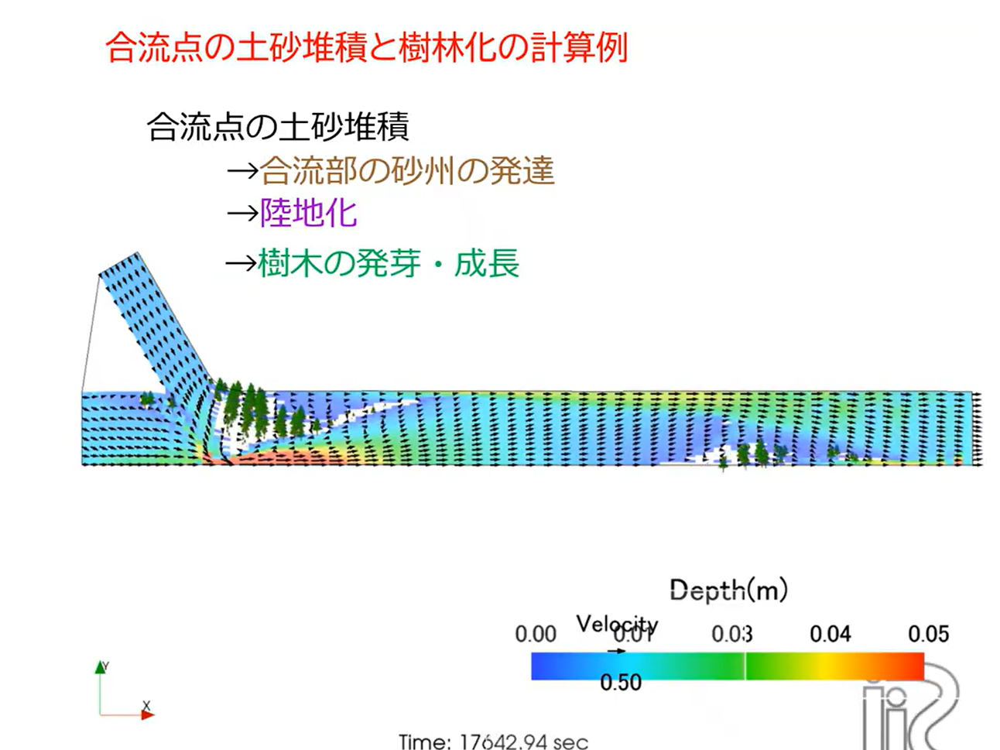

植生と河床・河岸の崩落
==========================

Cabernet2Dには，樹木などの植生が流れ・河床変動に与える影響を扱う機能と，
河床・河岸の急勾配斜面が安息角を超えたときに崩れる現象を扱う機能があります．
いずれも，単純な土砂輸送計算だけでは再現できない河道の地形変化（中州の
樹林化，貯水池堆砂の急崖など）を表現するために重要な機能です．

植生の影響
-------------

植生の抵抗
~~~~~~~~~~~~~

GUIの「Vegetation(1)」タブで，植生による流れの抵抗を考慮するかどうかを
「Effect of Vegetation Drag」で選択します．有効にすると，植生の抗力係数
（Drag coefficient of tree）・植生密度・植生高さから，運動方程式に抗力項が
追加されます．また「Consider vegetation effect in water continuity」を
有効にすると，植生が密生したセルでは水が流れにくくなる効果（連続式への
影響）も考慮できます．

植生の成長
~~~~~~~~~~~~~

「Consider Vegetation Growth」を有効にすると，裸地（植生のないセル）に
一定の水深条件（Minimum Depth for Vegetation Growth）が満たされると植生が
発芽し，時間とともに樹高・根長・密度が成長するモデルが働きます．成長開始
時刻や，成長が飽和に達するまでの時間（Time to reach vegetation saturation）
などを設定できます．

このモデルは，中州や合流点付近に土砂が堆積して陸地化し，そこに樹木が定着
して樹林化が進む，という河川で実際に見られる地形発達過程を表現するために
使われます．

   合流点での土砂堆積が陸地化し，樹木が発芽・成長する計算例．

植生の消失（侵食・流失）
~~~~~~~~~~~~~~~~~~~~~~~~~~~

植生は河床侵食や流れの力によって失われることもあります．

- **Consider Vegetation Loss due to Erosion**：河床侵食によって根が露出し，
  植生が流失する効果を考慮します．
- **Lodging of trees due to flow moment**：流れが樹木に及ぼすモーメントが
  臨界値（Critical moment variation factor で調整）を超えると，樹木が
  倒伏（なぎ倒される）するモデルです．

河床・河岸の崩落（Avalancheモデル）
---------------------------------------

なぜ必要か
~~~~~~~~~~~~~

通常の流砂連続式は「流速が低下すると輸送能力が低下し土砂が堆積する」という
物理を扱いますが，堆積した土砂が斜面として力学的に安定でいられるかどうか
（安息角を超えていないか）は評価していません．このため，流砂計算だけでは
堆積形状は急崖にならず，緩やかな丘状になってしまいます．

例えば貯水池への流入土砂は，上流側の緩勾配な堆積面（topset）と，その先の
安息角に支配された急崖（foreset），さらに下流側の浮遊砂による薄い堆積
（bottomset）という特徴的な3部構成の地形を形成することが知られています．
この急崖（foreset）を再現するには，安息角に基づく力学的安定性の評価が
不可欠です．

モデルの考え方
~~~~~~~~~~~~~~~~~

GUIの「Slope collapse / Avalanche model (j_ebank)」を有効にすると，毎
タイムステップ，隣り合うセル間の河床勾配を評価し，安息角（Tangent value of
angle of repose, tantc_e）を超えたセル対の河床高を調整（上流側セルを削り
下流側セルへ移動）します．あるセルが安定化すると隣のセルが新たに安息角を
超えることがあるため，すべてのセル対の勾配が安息角以下になるまで反復計算を
行います．崩落で移動する土砂量はそのまま下流側セルへ加算されるため，土砂の
総量は変化しません（質量保存）．

パラメータ
~~~~~~~~~~~~~

.. list-table::
   :header-rows: 1
   :widths: 30 70

   * - パラメータ
     - 説明
   * - Tangent value of angle of repose (tantc_e)
     - 安息角 :math:`\varphi` ではなく，その正接値 :math:`\tan\varphi` を
       入力します．既定値0.3（約17°）．
   * - Collapse direction (je_direction)
     - 崩落を評価する方向．(1) 縦断方向のみ／(2) 横断方向のみ／(3) 両方向．
   * - Start time of bed slope avalanche (stebank)
     - 崩落計算を開始する時刻（秒）．

.. list-table::
   :header-rows: 1
   :widths: 30 20 50

   * - 安息角 :math:`\varphi`
     - :math:`\tan\varphi`
     - 適用例
   * - 30°
     - 0.58
     - 自然の砂の代表値
   * - 17°
     - 0.30
     - 既定値（大きいスケール向き）
   * - 〜6°
     - 0.10
     - 格子が粗い場合の目安
   * - 〜3°
     - 0.05
     - 実験水路スケールの目安

.. important::

   数値モデルで表現できる最大勾配は「隣接セル間の河床高差 ÷ セル幅」で
   決まります．堆積高がセル幅に対して小さい場合（薄い堆積・粗い格子）には，
   物理的な安息角（例：砂で :math:`\tan 30° = 0.58`）をそのまま入力しても
   崩落が発生しないことがあります．対象とする現象のスケール（堆積高さと
   格子幅の比）に合わせて値を調整してください．

.. list-table::
   :header-rows: 1
   :widths: 30 20 20 30

   * - 対象
     - 堆積高 H
     - 格子幅 Δx
     - 推奨 :math:`\tan\varphi`
   * - 実験水路（小型）
     - 〜1 cm
     - 5〜10 cm
     - 0.05〜0.10
   * - 実験水路（中型）
     - 〜5 cm
     - 10〜20 cm
     - 0.05〜0.15
   * - 実河川・ダム貯水池
     - 1〜10 m
     - 10〜100 m
     - 0.05〜0.30

適用上の注意
~~~~~~~~~~~~~~~

風上差分スキームや人工粘性は，数値的な平滑化を通じて河床形状を拡散させる
効果を持ちます．Avalancheモデルによる急崖形成の効果を純粋に確認したい
場合は，まず中央差分・人工粘性なしの設定で試すことをお勧めします．計算が
振動・不安定になる場合は，風上差分への変更，あるいは人工粘性係数（0.05〜
0.10程度）の追加で安定化できます．
