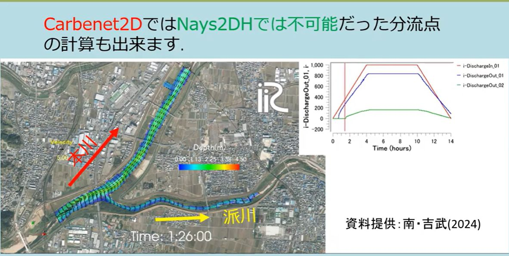

複合河道網（分岐・合流）
============================

Cabernet2Dは，単純な1本の水路だけでなく，分派（分岐）や合流を含む複合的な
河道網を，1つの計算領域として一体で計算できます．Nays2DHでは計算が難しかった
分流点（本川から派川への流量配分）の計算も可能です．

   分流点（本川・派川）を含む複合河道網の計算例．本川・派川それぞれの流量が
   時間的に変化しながら配分される．
   （資料提供：南・吉武 (2024)）

計算モードの切り替え
------------------------

GUIの計算条件「Type (j_discharge)」で，計算対象の河道形状に応じたモードを
選択します．

.. list-table::
   :header-rows: 1
   :widths: 15 85

   * - 設定
     - 説明
   * - (0) Simple channel
     - 流入・流出が1か所ずつの単純な水路．
   * - (1) Complex channel
     - 流入・流出が複数ある複合河道網（分岐・合流を含む）．

(1)を選択すると，格子上で複数の流入境界・流出境界をそれぞれ個別に設定できる
ようになります．境界の位置と条件は，GUIの境界条件画面で，格子の辺（edge）を
選択して設定します．

流出境界条件の種類
----------------------

各流出境界（i方向・j方向それぞれ）で，以下のいずれかの水位条件を選択します．

.. list-table::
   :header-rows: 1
   :widths: 15 85

   * - 設定
     - 説明
   * - (0)
     - 壁条件（流量ゼロ）
   * - (1)
     - 自由流出（水面勾配一定）
   * - (2)
     - 一定水位（m）
   * - (3)
     - 水位の時系列（m）
   * - (4)
     - 自由流出（水深勾配ゼロ）
   * - (5)
     - 限界水深
   * - (6)
     - 等流（Manning公式による等流水位）。この出口に流れ込む全流入境界の
       合計流量を目標として，Manning公式から等流水位を毎ステップ算定します．
       この条件を選ぶ場合は，あわせて「Slope in i/j-direction at outflow
       boundary」（等流計算に使う勾配）を設定してください．

.. note::

   (6) 等流条件は，全流入境界の合計流量を目標流量として使います．このため，
   **本来は上流端・下流端が1か所ずつの単純な水路（あるいは河道網全体でただ
   1つの出口）を想定した条件** です．分岐した河道網で，個々の出口ごとに
   別々の等流水位を与えたい場合（例えば分流後の派川側の出口）には，合計
   流入量を使うこの条件では水位を過大・過小評価することがあります．対象と
   する河道網の形状に応じて，他の条件（時系列水位など）と組み合わせて
   調整することをお勧めします．

また，「Use Riemann invariant condition for outflow boundary」
（hRiemann_i/j）を有効にすると，指定した水位条件のもとで，境界流速を内部の
Riemann不変量から整合的に決定します（一定水位・時系列水位・等流水位の場合
に使用可能）．

実務上のヒント
-------------------

- 分岐・合流を含む河道網では，各出口境界の水位条件の設定次第で計算の安定性
  が大きく左右されます．特に実験水路スケールなど水深が小さい場合，水位の
  初期値・探索範囲の基準となる「Reference depth」を水路の代表水深スケール
  （cmオーダーなど）に合わせて設定することが重要です．
- 複合河道網モードでは，上流側の浮遊砂供給比率（Upstream suspended sediment
  supply ratio）は計算条件の設定ではなく，各流入境界ごとの設定が使われます．
  流入境界が複数ある場合は，それぞれの境界で個別に設定してください．
- 分岐点・合流点周辺は流れが急激に変化する場所なので，局所的な洗掘・堆積
  パターンを精度よく再現したい場合は，準三次元流れ計算法（:doc:`05_QuasiThreeDimensionalFlow`）
  の併用も検討してください．ただし分岐点形状によっては数値的な安定化の
  検討が追加で必要になる場合があります．
