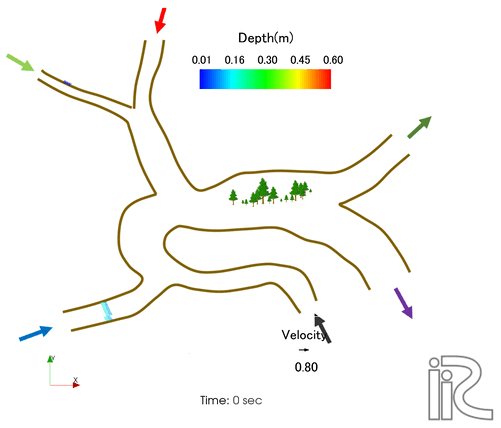

.. NaysMini example manual documentation master file, created by
   sphinx-quickstart on 30 Mar 2021.
   You can adapt this file completely to your liking, but it should at least
   contain the root `toctree` directive.

2次元河川網総合解析ツール[カベルネ2D(Cabernet2D)]のページへようこそ!
=======================================================================

`English version <en/index.html>`_

.. contents: Contents
   :depth: 4

.. toctree::
   :maxdepth: 3

   01_Introduction
   02_Overview
   03_Example(1)
   04_Example(2)
   05_QuasiThreeDimensionalFlow
   06_MixedGrainSize
   07_VegetationAndBankCollapse
   08_MultiChannelNetworks
   09_BoundaryConditions
   10_StructuresAndControlDevices
   11_UndergroundFloodExchange
   12_MaterialTransport
   13_ComputationSettings

