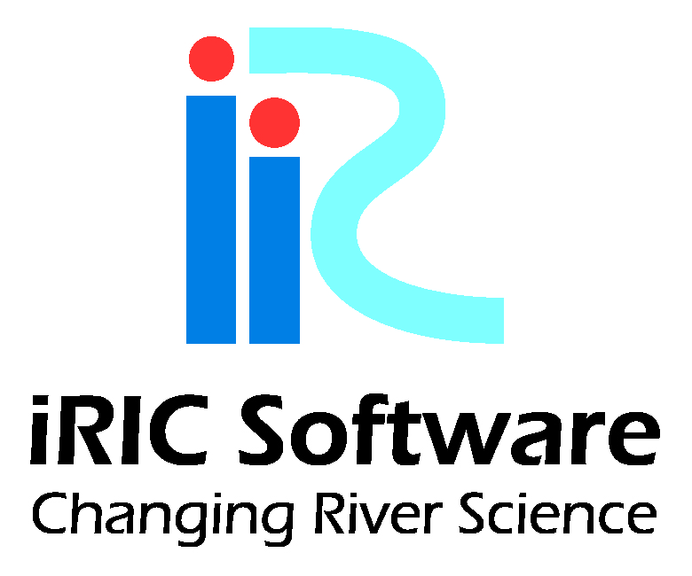

Introduction
============

Cabernet2D is pronounced like the French grape variety "Cabernet Sauvignon,"
but the name is actually an acronym for "Comprehensive Aquatic Basin
Evaluation Tool." Built on Nays2DH, iRIC's representative 2D open-channel
flow solver, Cabernet2D is a comprehensive river network analysis tool that
adds flow and bed variation calculation for channel networks with multiple
confluences and bifurcations, a vegetation growth/loss model, and the basic
functionality of the GELATO material-transport model.

September 14, 2024
`Yasuyuki Shimizu <https://i-ric.org/yasu/>`_
