Example (1) Computing a River with a Confluence
====================================================
In this example we compute a river that includes a confluence/bifurcation.

Starting iRIC and selecting the solver
----------------------------------------

On the iRIC opening screen, select [New Project] (:numref:`01_start`).

   .. _01_start:

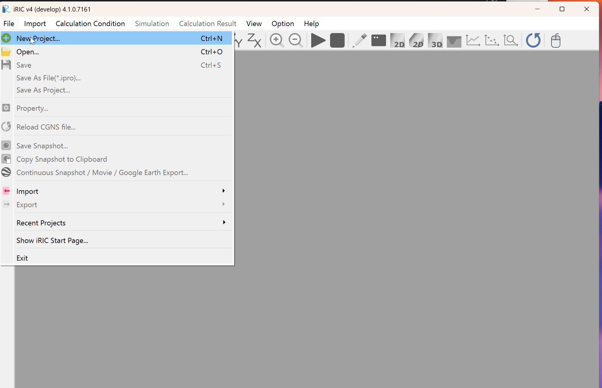

   : New Project

In the solver selection window shown in :numref:`02_select`, select
[Cabernet2d] and press [OK].

   .. _02_select:

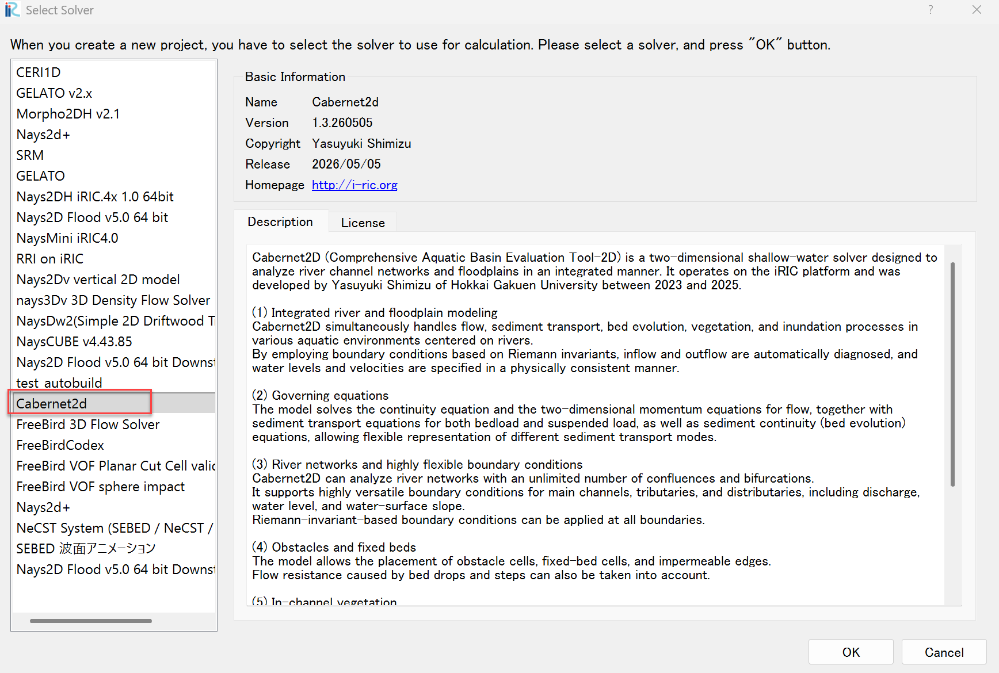

   : Selecting the solver

Creating the computational grid
-------------------------------------

To set the scale of the current preprocessor view, set a reference line
(here, 100 m) following the animation below.

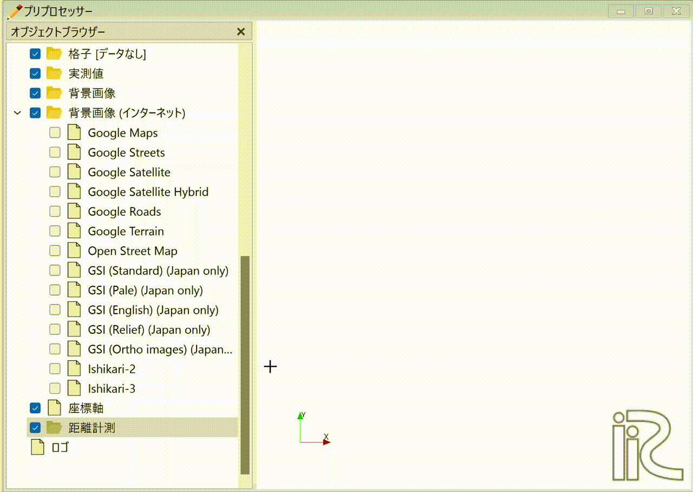

   : Drawing the reference line

From the main menu, choose [Grid] -> [Select Grid Generation Algorithm].

   .. _koshi_1:

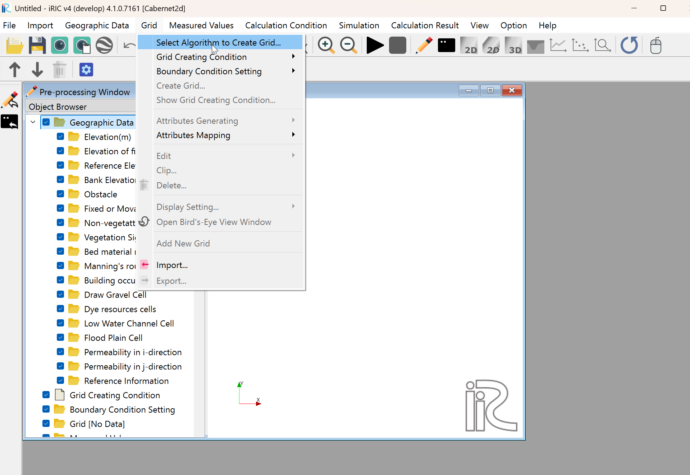

   : Grid generation (1)

In the [Select Grid Generation Algorithm] window, choose [General-purpose
grid generation tool] and press [OK].

   .. _koshi_2:

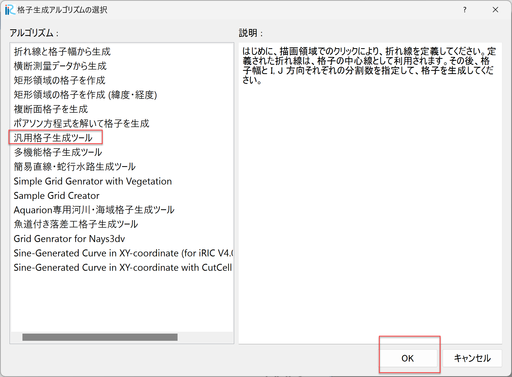

   : Grid generation (2)

A message "Cross-section survey data not found. Please create it
yourself." appears; press [OK].

   .. _warning_1:

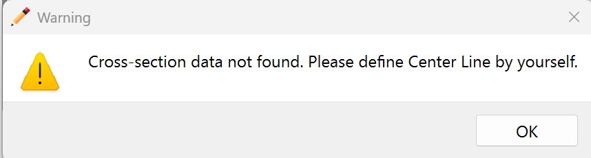

   : Warning dialog (1)

Generate the grid following these steps.

1. Hold down the right mouse button and drag to draw the channel center
   line, finishing with a double-click.
2. Right-click on the drawn reference line and select [Generate Left/Right
   Bank Lines (B)].
3. Enter the distance (m) from the center line to the left and right banks
   and press [OK]. (Here, 30 m is used on each side.)
4. Specify the subdivision lines, grid spacing and other conditions.
5. Set the land area between the upstream main channel and the tributary
   as an obstacle.

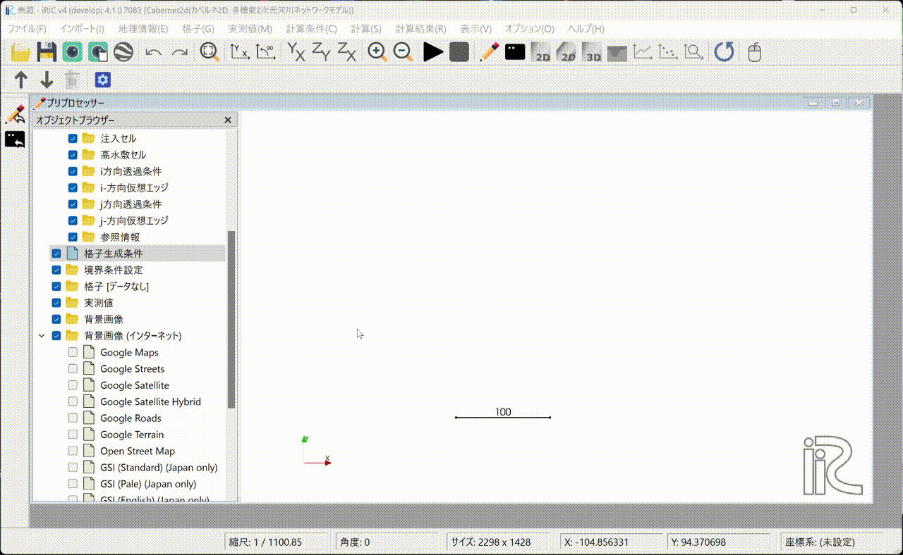

   : Grid generation

Setting boundary and calculation conditions
-----------------------------------------------

Set the boundary conditions for the inflow and outflow sections.

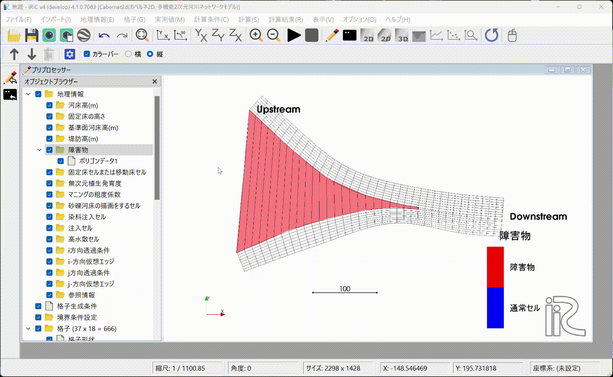

   : Setting boundary conditions

Map the obstacle information and the boundary condition information onto
the computational grid.

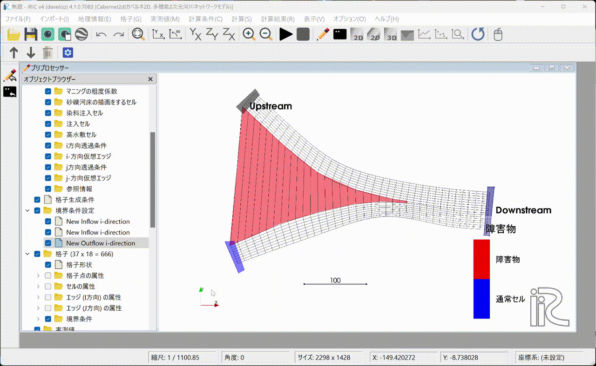

   : Running the mapping

Set the calculation conditions.

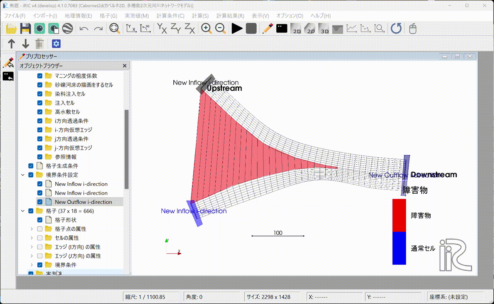

   : Setting the calculation conditions

Running the computation and displaying the results
-------------------------------------------------------

Run the computation. The first time you run it, you will be asked whether
to save the project. Here, we save the project with a new name in a new
folder. If you prefer, you can also save the project as a compressed
``.ipro`` file.

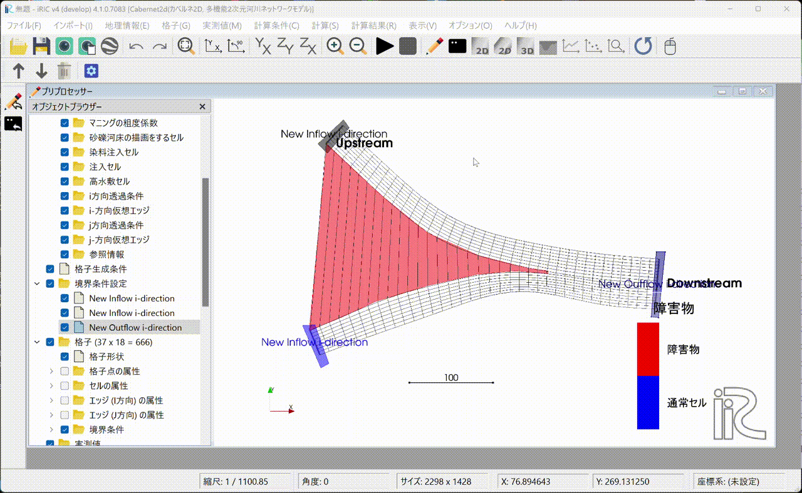

   : Running the computation

Displaying the results (1). Open the 2D post-processing window to display
the computation results. In this example we ran a 60-second computation,
but at 60 seconds the flow does not appear to have reached the downstream
end yet.

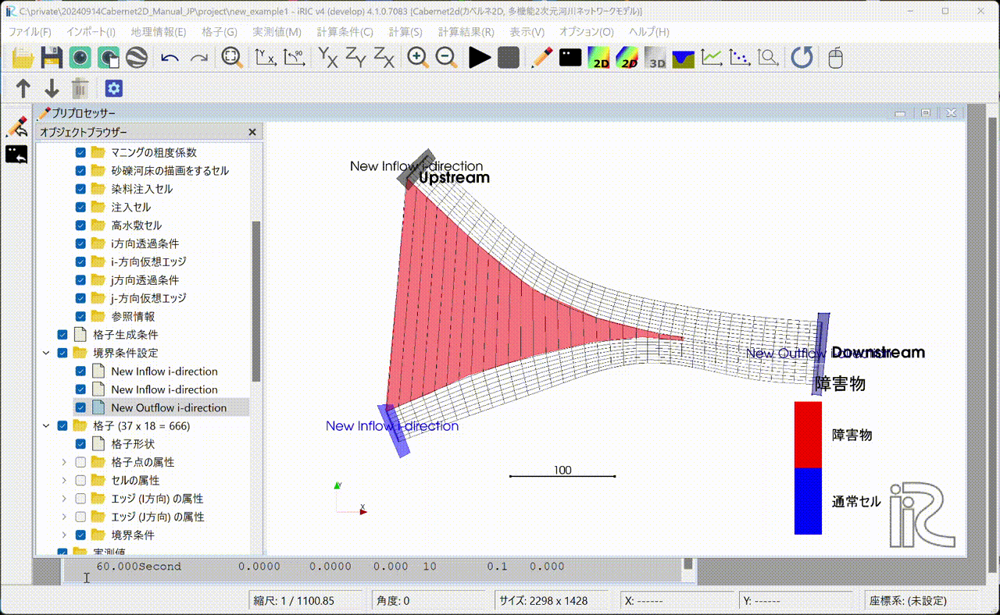

   : Displaying the results (1)

Set the computation time to 600 seconds. Change the boundary and
calculation conditions accordingly, run the mapping again, re-run the
computation, and display the results in the post-processing window.

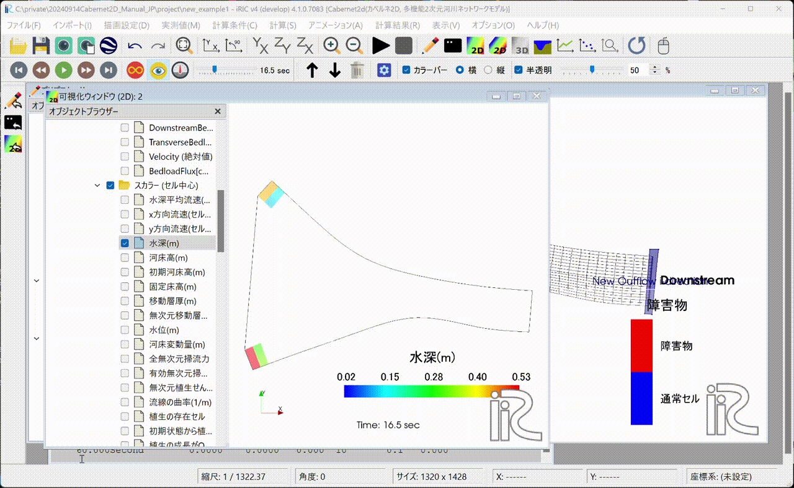

   : Changing conditions, re-running, and displaying the results (2)

Create a discharge hydrograph, longitudinal water-level profile, and other
plots, and build an animation from them.

.. figure:: images_1/ju_anim.gif
   :width: 70%
   :align: center

   : Creating plots and building an animation

The resulting animation is shown below.

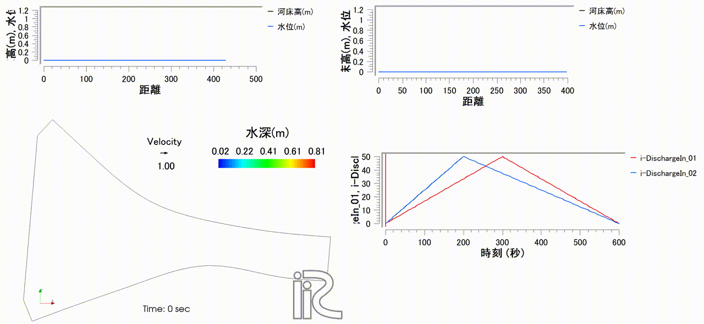

   : Animation of the computation results

The above results are also published on YouTube.

.. raw:: html

   <iframe width="560" height="315" src="https://www.youtube.com/embed/K3bJgVvoLF4?si=MjgZuWUNg4Bz5nqB" title="YouTube video player" frameborder="0" allow="accelerometer; autoplay; clipboard-write; encrypted-media; gyroscope; picture-in-picture; web-share" referrerpolicy="strict-origin-when-cross-origin" allowfullscreen></iframe>
