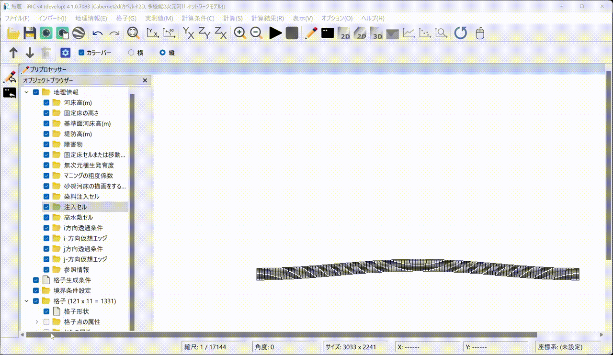
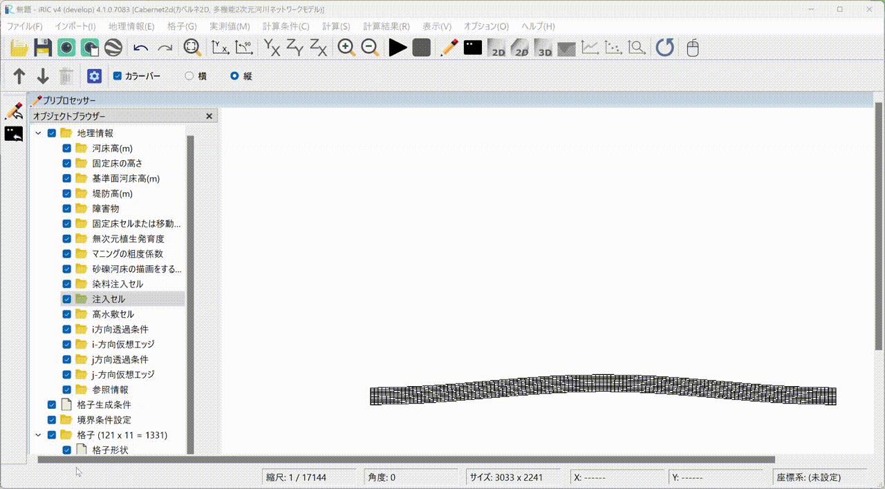

Example (2) Flow and Bed Variation with Vegetation Growth and Loss
========================================================================

Creating the computational grid
-------------------------------------

From the main menu, choose [Grid] -> [Select Grid Generation Algorithm] and
generate the computational grid following the steps in the animation below.

   .. _grigen(2):

   : Grid generation

Setting the calculation conditions
----------------------------------------

Set the calculation conditions following the steps in the animation below.

   .. _calcond(2):

   : Setting the calculation conditions

The discharge hydrograph file loaded during the animation above can be
found `here <https://i-ric.org/yasu/cabernet/example2/Linear.csv>`_.

The calculation condition file can be found
`here <https://i-ric.org/yasu/cabernet/example2/vegetation.yml>`_; please
download and use it.

Running the computation
----------------------------

   .. _execute(2):

   : Running the computation

Displaying the results and building an animation
-------------------------------------------------------

   .. _post(2):

.. figure:: images_2/post_2.gif
   :width: 90%
   :align: center

   : Displaying the results and building an animation

The above results are also published on YouTube.

.. raw:: html

   <iframe width="560" height="315" src="https://www.youtube.com/embed/zQ5dRpHoMGg?si=cmmmV5nLGO5TiQE7" title="YouTube video player" frameborder="0" allow="accelerometer; autoplay; clipboard-write; encrypted-media; gyroscope; picture-in-picture; web-share" referrerpolicy="strict-origin-when-cross-origin" allowfullscreen></iframe>
