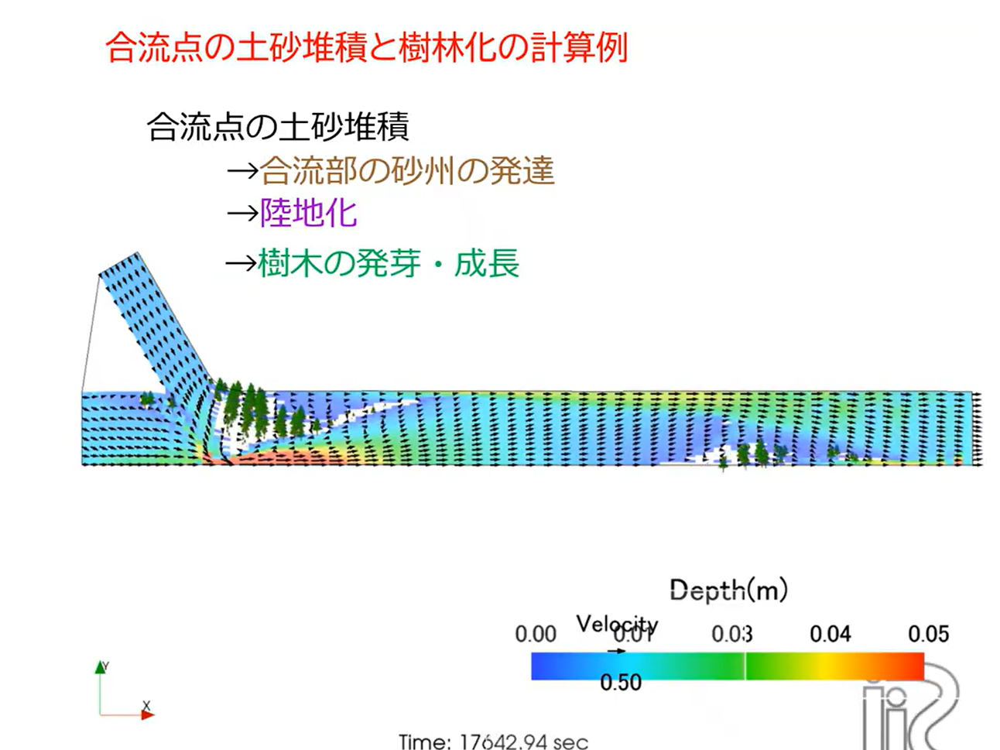

Vegetation and Bed/Bank Slope Failure
==========================================

Cabernet2D includes a model for the effect of vegetation (such as trees) on
the flow and bed variation, and a model for the failure of steep bed/bank
slopes once they exceed the angle of repose. Both are important for
reproducing topographic changes that a simple sediment-transport
calculation alone cannot capture, such as the vegetation establishment on
a sandbar or the steep delta front slope in a reservoir.

Effects of vegetation
-------------------------

Vegetation drag
~~~~~~~~~~~~~~~~~~~

In the GUI "Vegetation(1)" tab, you choose whether to consider the drag
effect of vegetation on the flow with "Effect of Vegetation Drag." When
enabled, a drag term is added to the momentum equations based on the drag
coefficient of the tree, vegetation density and vegetation height. Enabling
"Consider vegetation effect in water continuity" also accounts for the
effect that densely vegetated cells are harder for water to flow through
(an effect on the continuity equation).

Vegetation growth
~~~~~~~~~~~~~~~~~~~~~

When "Consider Vegetation Growth" is enabled, vegetation sprouts in bare
cells (cells without vegetation) once a minimum depth condition (Minimum
Depth for Vegetation Growth) is satisfied, and its height, root length and
density grow over time according to a growth model. You can set the growth
start time, the time to reach growth saturation (Time to reach vegetation
saturation), and other parameters.

This model is used to represent the kind of land-forming process actually
observed in rivers, in which sediment deposited near a sandbar or
confluence turns into dry land, and trees then establish themselves and
grow there.

   An example calculation in which sediment deposition at a confluence
   turns into land, followed by vegetation germination and growth.

Loss of vegetation (erosion and washout)
~~~~~~~~~~~~~~~~~~~~~~~~~~~~~~~~~~~~~~~~~~~

Vegetation can also be lost to bed erosion or the force of the flow.

- **Consider Vegetation Loss due to Erosion**: accounts for the effect that
  bed erosion exposes the roots and washes the vegetation away.
- **Lodging of trees due to flow moment**: a model in which trees are
  knocked down (lodged) once the moment exerted by the flow on the tree
  exceeds a critical value (adjusted with "Critical moment variation
  factor").

Bed/bank slope failure (the Avalanche model)
-------------------------------------------------

Why it is needed
~~~~~~~~~~~~~~~~~~~~

The ordinary sediment-continuity calculation handles the physics of "when
the flow velocity drops, the transport capacity decreases and sediment is
deposited," but it does not evaluate whether the deposited sediment can
remain mechanically stable as a slope (i.e., whether it exceeds the angle
of repose). Because of this, a sediment-transport calculation alone cannot
reproduce a steep cliff face; the resulting deposit shape instead becomes a
gentle mound.

For example, sediment flowing into a reservoir is known to form a
characteristic three-part topography: a gently sloping deposit surface
upstream (the topset), a steep cliff governed by the angle of repose ahead
of it (the foreset), and a thin layer of suspended-sediment deposit further
downstream (the bottomset). Reproducing this foreset cliff requires
evaluating mechanical stability based on the angle of repose.

How the model works
~~~~~~~~~~~~~~~~~~~~~~~

When "Slope collapse / Avalanche model (j_ebank)" is enabled in the GUI,
the bed slope between adjacent cells is evaluated at every time step, and
for any cell pair whose slope exceeds the angle of repose (Tangent value
of angle of repose, tantc_e), the bed elevations are adjusted (the upstream
cell is lowered and the sediment is moved to the downstream cell). Because
stabilizing one cell can cause a neighboring cell to newly exceed the angle
of repose, this is repeated iteratively until the slope of every cell pair
is at or below the angle of repose. The sediment volume moved by a
collapse is simply added to the downstream cell, so the total sediment
volume does not change (mass is conserved).

Parameters
~~~~~~~~~~~~~

.. list-table::
   :header-rows: 1
   :widths: 30 70

   * - Parameter
     - Description
   * - Tangent value of angle of repose (tantc_e)
     - Enter the tangent :math:`\tan\varphi` of the angle of repose
       :math:`\varphi`, not the angle itself. Default value 0.3
       (about 17°).
   * - Collapse direction (je_direction)
     - The direction(s) in which collapse is evaluated: (1) downstream
       direction only / (2) cross-sectional direction only / (3) both
       directions.
   * - Start time of bed slope avalanche (stebank)
     - The time (seconds) at which the collapse calculation starts.

.. list-table::
   :header-rows: 1
   :widths: 30 20 50

   * - Angle of repose :math:`\varphi`
     - :math:`\tan\varphi`
     - Typical application
   * - 30°
     - 0.58
     - Representative value for natural sand
   * - 17°
     - 0.30
     - Default value (suited to larger scales)
   * - ~6°
     - 0.10
     - A guideline for coarser grids
   * - ~3°
     - 0.05
     - A guideline for experimental flume scales

.. important::

   The maximum slope a numerical model can represent is determined by
   "the bed elevation difference between adjacent cells divided by the
   cell width." When the deposit height is small relative to the cell
   width (a thin deposit on a coarse grid), entering the physical angle
   of repose as-is (e.g., :math:`\tan 30° = 0.58` for sand) may result in
   no collapse occurring at all. Adjust the value to match the scale of
   the phenomenon you are modeling (the ratio of deposit height to grid
   spacing).

.. list-table::
   :header-rows: 1
   :widths: 30 20 20 30

   * - Target
     - Deposit height H
     - Grid spacing Δx
     - Recommended :math:`\tan\varphi`
   * - Experimental flume (small)
     - ~1 cm
     - 5-10 cm
     - 0.05-0.10
   * - Experimental flume (medium)
     - ~5 cm
     - 10-20 cm
     - 0.05-0.15
   * - Real river / reservoir
     - 1-10 m
     - 10-100 m
     - 0.05-0.30

Notes on application
~~~~~~~~~~~~~~~~~~~~~~~~

Upwind-difference schemes and artificial viscosity have a smoothing effect
that numerically diffuses the bed shape. If you want to verify the effect
of the Avalanche model's cliff formation in isolation, we recommend first
trying it with central differencing and no artificial viscosity. If the
computation becomes oscillatory or unstable, you can stabilize it by
switching to an upwind-difference scheme, or by adding artificial
viscosity (a coefficient of around 0.05-0.10).
