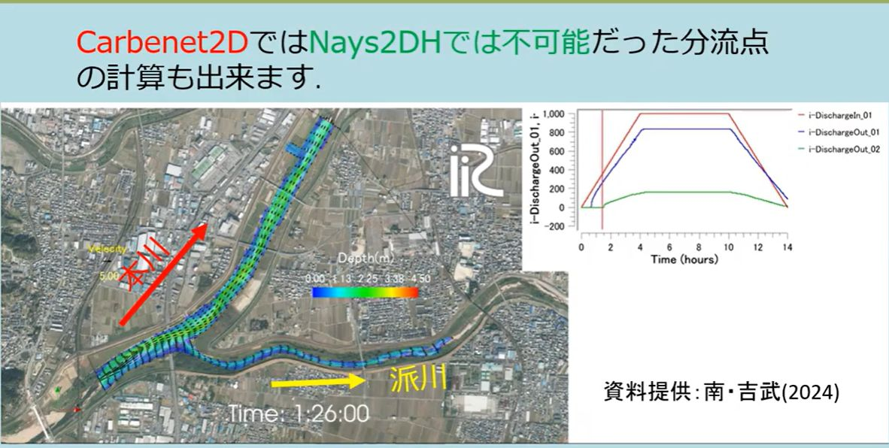

Multi-Channel Networks (Bifurcation and Confluence)
=========================================================

Cabernet2D can compute not just a single simple channel, but a complex
river network that includes bifurcations (branches) and confluences, all
within a single computational domain. This makes it possible to compute
flow division at a bifurcation point (the distribution of discharge
between the main channel and a branch), which was difficult with Nays2DH.

   An example computation of a multi-channel network with a bifurcation
   point (main channel and branch channel). The discharge in the main
   channel and the branch is distributed while varying over time.
   (Data courtesy of Minami & Yoshitake, 2024)

Switching the calculation mode
-----------------------------------

In the GUI calculation condition "Type (j_discharge)," choose the mode that
matches the shape of the channel network you are computing.

.. list-table::
   :header-rows: 1
   :widths: 15 85

   * - Setting
     - Description
   * - (0) Simple channel
     - A simple channel with a single inflow and a single outflow.
   * - (1) Complex channel
     - A complex channel network (including bifurcations and confluences)
       with multiple inflows and/or outflows.

When (1) is selected, you can set multiple inflow and outflow boundaries
individually on the grid. The location and condition of each boundary are
set in the GUI's boundary condition screen by selecting the corresponding
edge(s) of the grid.

Types of outflow boundary condition
-----------------------------------------

For each outflow boundary (in the i-direction and the j-direction), choose
one of the following water-level conditions.

.. list-table::
   :header-rows: 1
   :widths: 15 85

   * - Setting
     - Description
   * - (0)
     - Wall condition (zero flux)
   * - (1)
     - Free outflow (constant water-surface slope)
   * - (2)
     - Constant water surface elevation (m)
   * - (3)
     - Time series of water surface elevation (m)
   * - (4)
     - Free outflow (zero depth gradient)
   * - (5)
     - Critical depth
   * - (6)
     - Uniform flow (Manning normal depth). The target is the sum of the
       discharge from all inflow boundaries that feed this outlet, and the
       uniform-flow water level is computed from Manning's formula at
       every time step. When choosing this condition, also set the
       "Slope in i/j-direction at outflow boundary" (the slope used in the
       uniform-flow calculation).

.. note::

   Condition (6), uniform flow, uses the sum of the discharge from all
   inflow boundaries as its target discharge. This means it is
   **fundamentally intended for a simple channel with a single upstream
   and downstream end (or a single outlet for the whole network)**. In a
   bifurcating network where you want to give each outlet its own,
   independent uniform-flow water level (for example, the outlet of a
   branch channel downstream of a bifurcation), this condition — which
   uses the total inflow — can over- or under-estimate the water level.
   Depending on the shape of the network you are computing, consider
   combining it with another condition (such as a time-series water
   level) and adjusting it as needed.

You can also enable "Use Riemann invariant condition for outflow boundary"
(hRiemann_i/j), which determines the boundary velocity consistently from
the internal Riemann invariant under the specified water-level condition
(available for the constant, time-series, and uniform-flow water-level
conditions).

Practical tips
------------------

- In a network with bifurcations and confluences, the stability of the
  computation depends strongly on how each outlet's water-level condition
  is set. In particular, at small-scale settings such as an experimental
  flume, where the water depth is small, it is important to set the
  "Reference depth" — which serves as the basis for the initial value and
  search range of the water level — to match the representative water
  depth scale of the channel (for example, on the order of centimeters).
- In the multi-channel mode, the "Upstream suspended sediment supply
  ratio" in the calculation conditions is not used; instead, the supply
  ratio set individually for each inflow boundary is used. If there are
  multiple inflow boundaries, set this value individually for each one.
- Because the area around a bifurcation or confluence is where the flow
  changes most abruptly, consider also using the quasi-3D flow calculation
  method (:doc:`05_QuasiThreeDimensionalFlow`) if you want to accurately
  reproduce the local scour and deposition pattern there. Depending on the
  shape of the bifurcation, however, additional work on numerical
  stabilization may be required.
