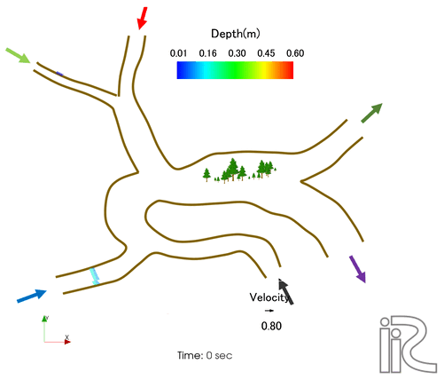

Welcome to the Cabernet2D manual
===================================

`日本語版はこちら <../index.html>`_

.. toctree::
   :maxdepth: 3

   01_Introduction
   02_Overview
   03_Example(1)
   05_QuasiThreeDimensionalFlow
   06_MixedGrainSize
   08_MultiChannelNetworks
   09_BoundaryConditions
   10_StructuresAndControlDevices
   11_UndergroundFloodExchange
   12_MaterialTransport
   13_ComputationSettings

.. Vegetation-related chapters temporarily masked (content kept, only removed from toctree):
   04_Example(2)
   07_VegetationAndBankCollapse
   To restore, move these back to their original positions above (after 03_Example(1) / after 06_MixedGrainSize).

