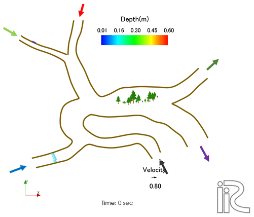

Welcome to the Cabernet2D manual
===================================

`日本語版はこちら <../index.html>`_

.. toctree::
   :maxdepth: 3

   01_Introduction
   02_Overview
   03_Example(1)
   04_Example(2)
   05_QuasiThreeDimensionalFlow
   06_MixedGrainSize
   07_VegetationAndBankCollapse
   08_MultiChannelNetworks

